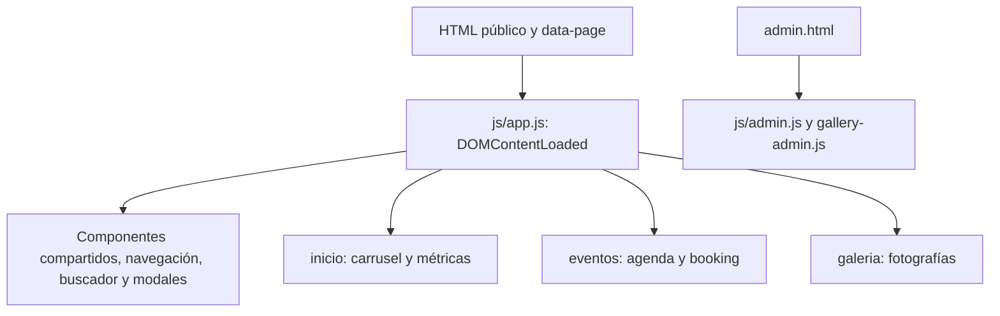

# Pablo Gómez | Sitio web oficial — Frontend Portfolio Project

**ES:** Proyecto de portfolio frontend para la presencia digital de un artista musical. Sitio multipágina con biografía, agenda, galería y componentes compartidos, construido con HTML, SCSS, JavaScript modular y Vite.

**EN:** Frontend portfolio project for a music artist. A multi-page website with a biography, event schedule, gallery and shared components, built with HTML, SCSS, modular JavaScript and Vite.

**Estado / Status:** Frontend sin backend. La agenda contiene eventos reales cargados manualmente; las métricas también se mantienen a mano. Las reservas y la administración de galería funcionan únicamente en el navegador. / Frontend without a backend. Real events and follower counts are maintained manually. Booking and gallery administration only store data in the browser.

[Código fuente / Source code](https://github.com/PabloGomezCr/pablogomezweboficial)

## Empezar / Quick start

Necesitás Node.js y npm. La versión de Vite instalada requiere **Node.js 20.19+ dentro de la rama 20, o 22.12+** (`^20.19.0 || >=22.12.0`). El proyecto no fija una versión de Node propia. Git es necesario si vas a clonar el repositorio.

```bash
git clone https://github.com/PabloGomezCr/pablogomezweboficial.git
cd pablogomezweboficial
npm ci
npm run dev
```

Ejecutá los comandos en la carpeta que contiene `package.json`. `npm ci` instala las versiones del `package-lock.json`; usá `npm install` cuando quieras actualizar dependencias y su archivo de bloqueo.

Abrí la dirección que indique Vite, normalmente `http://localhost:5173/`. Mantené la terminal abierta mientras trabajás y detené el servidor con `Ctrl+C`. Si el puerto está ocupado, Vite puede elegir otro: revisá la dirección mostrada antes de abrir un segundo servidor.

Los HTML enlazan `scss/main.scss` y usan módulos JavaScript. Abrilos mediante Vite: abrir un archivo directamente o usar Live Server no realiza esta compilación de SCSS.

**EN:** Install a compatible Node.js version, run the commands above from the repository root, then open the URL printed by Vite. Keep the terminal running while editing. Use Vite rather than opening the HTML files directly.

| Comando | Para qué sirve |
| --- | --- |
| `npm run dev` | Desarrollo con actualización de HTML, JavaScript y SCSS. |
| `npm run build` | Genera la versión optimizada en `build/`. No publica el sitio. |
| `npm run preview` | Sirve el último build para revisarlo localmente; abrí la URL indicada. No recompila cambios. |

Para revisar la versión compilada, ejecutá primero `npm run build` y después `npm run preview`. Repetí el build si editás fuentes. Las únicas dependencias directas declaradas son Vite y Sass, ambas de desarrollo; no hay framework de interfaz ni backend.

## Páginas

| Archivo | Contenido |
| --- | --- |
| [index.html](index.html) | Portada, seguidores de Instagram/TikTok y carrusel de videos en vivo. |
| [biografia.html](biografia.html) | Biografía en tres capítulos con imágenes y textos editables. |
| [eventos.html](eventos.html) | Agenda con filtros, páginas numeradas y formulario de booking local. |
| [galeria.html](galeria.html) | Fotografías y sus datos, con apertura en modal. |
| [admin.html](admin.html) | Panel de demostración para editar la galería en este navegador. |

Las cuatro páginas públicas comparten navegación, buscador, footer, contacto flotante y modales legales. El panel administrativo también inicializa los componentes compartidos.

## Mapa del código

```text
pablogomezweboficial/
├── index.html, biografia.html, eventos.html, galeria.html, admin.html
├── js/
│   ├── app.js                     # Entrada de las páginas públicas
│   ├── admin.js                   # Entrada del panel local
│   ├── components/
│   │   └── shared-components.js    # Navegación, footer, contacto y textos legales
│   ├── modules/
│   │   ├── events.js              # Datos de agenda, filtros, páginas y booking
│   │   ├── gallery.js             # Datos y tarjetas de galería
│   │   ├── gallery-admin.js       # Edición local de fotografías
│   │   ├── search.js              # Índice de búsqueda manual
│   │   ├── navbar.js, carousel.js, modal.js
│   │   └── storage.js             # Acceso a LocalStorage con prefijo pg_
│   └── services/social-api.js     # Seguidores manuales y conexión opcional a API
├── scss/
│   ├── main.scss                 # Importa todos los estilos
│   ├── abstracts/                # Variables, funciones y mixins
│   ├── base/                     # Reset, tipografía y estilos generales
│   ├── components/               # Footer, botones, navbar, tarjetas, modales…
│   ├── layout/                   # Distribución, portada y secciones
│   └── pages/                    # Ajustes de cada página, incluido admin
├── assets/                       # Imágenes, videos, iconos y otros recursos
├── css/styles.css                # Copia antigua; los HTML no la cargan
├── vite.config.js                # Entradas HTML y salida de compilación
├── package.json, package-lock.json
├── robots.txt, sitemap.xml
└── build/                        # Salida generada e ignorada por Git
```

### Cómo arranca la interfaz



`app.js` usa `data-page` del elemento `<html>` para elegir qué módulos iniciar. Biografía utiliza los componentes comunes y conserva su contenido en HTML. `admin.js` tiene su propia entrada para la edición local.

`initSharedComponents()` reemplaza el contenido de la cabecera y el footer al iniciar. Para cambiar lo que ve el usuario, editá [shared-components.js](js/components/shared-components.js), no solamente la copia del footer en un HTML. Si cambia un enlace o contenido compartido, mantené también coherente el HTML de respaldo.

## Dónde editar cada cosa

### Agenda

La fuente es el arreglo `events` en [js/modules/events.js](js/modules/events.js). Actualmente contiene **14 eventos reales de octubre y noviembre de 2026**; no se descargan desde una API ni se sustituyen por una agenda guardada en caché.

Cada evento usa un `id` único, `title`, fecha `YYYY-MM-DD`, hora `HH:mm`, ciudad y, cuando se conoce, `venue`. Por ejemplo, este registro ya existe:

```javascript
{ id: 15, title: 'Jorcos', date: '2026-11-14', time: '22:00', venue: 'Jorcos', city: 'Puntarenas', status: 'available' }
```

Para eventos de día completo, usá `allDay: true` y omití `time`. Así está representada la fiesta privada del 29 de noviembre en San José, que muestra **Todo el día**. Si no se conoce el lugar, omití `venue`; no hace falta inventar uno. Un evento sin hora ni `allDay` muestra **Hora por confirmar**.

La agenda:

- Filtra por Hoy, Esta semana (lunes a domingo), Este mes, Próximos eventos, Eventos pasados y Todos.
- Ordena por fecha y hora; los registros sin hora quedan después de los que tienen hora en la misma fecha.
- Muestra hasta **cuatro tarjetas por página**, con botones numéricos y un conteo del total filtrado. Cambiar el filtro vuelve a la página 1.
- Considera pasado un evento cuando termina su día, según la fecha local del navegador; **no** al llegar su hora de inicio.
- Se actualiza al cambiar de día y al volver a la pestaña o ventana tras una suspensión. Conserva el filtro, ajusta los límites de paginación y no reinicia el formulario.

Los estilos de tarjetas, filtros y paginación están en [scss/pages/_eventos.scss](scss/pages/_eventos.scss). El booking consulta el mismo arreglo para bloquear días ocupados: reserva el día completo aunque el evento tenga una hora concreta.

### Seguidores de redes sociales

En [js/services/social-api.js](js/services/social-api.js), `MANUAL_DATA` contiene los valores **1994 para Instagram** y **1362 para TikTok**. La portada muestra **1.994** y **1.362**, sin abreviar, con el formato definido en `formatFollowers()` de [js/app.js](js/app.js).

Para actualizar estas cifras, editá `MANUAL_DATA` y los valores de respaldo en `index.html`. Mientras la etiqueta siguiente esté vacía, los valores manuales tienen prioridad y no se sobrescriben con una caché anterior:

```html
<meta name="social-api-endpoint" content="">
```

La conexión a una API es opcional y **no está configurada**. Si se configura, el servicio espera JSON con `instagram.followers` y `tiktok.followers` numéricos y un `updatedAt` opcional. Intenta consultar el endpoint durante 4,5 segundos; si falla, utiliza una caché válida procedente de la API o los valores manuales. No hay actualización periódica de seguidores. Cualquier credencial privada necesaria para consultar redes debe permanecer en un backend, no en el JavaScript del navegador.

### Textos, fotos, videos y búsqueda

| Cambio | Fuente |
| --- | --- |
| Portada, videos y textos de inicio | `index.html` y archivos referenciados en `assets/`. |
| Biografía e imágenes de capítulos | `biografia.html`. |
| Fotografías y metadatos de galería | Arreglo `galleryItems` en `js/modules/gallery.js`. |
| Redes, navegación, contacto y contenido legal compartido | `js/components/shared-components.js`. |
| Términos y enlaces del buscador | Arreglo `searchIndex` en `js/modules/search.js`. |
| Colores, tipografías y medidas comunes | `scss/abstracts/_variables.scss`. |
| Distribución y hover/foco del footer | `scss/components/_footer.scss`. |

El buscador recorre su índice manual; no indexa automáticamente todos los textos ni los nuevos eventos. Actualizalo si agregás secciones que deban encontrarse.

### Estilos

Editá `scss/`; Vite compila [scss/main.scss](scss/main.scss) mediante Sass durante desarrollo y build. No necesitás otro proceso de compilación. `css/styles.css` es una copia antigua: editarla no cambia las páginas actuales.

El footer permite saltos de enlaces completos, conserva juntos icono y nombre y adapta las columnas a móvil. Sus iconos SVG se importan con `?raw` en el componente compartido y utilizan `currentColor` en las figuras para cambiar a dorado junto con el texto en hover o foco de teclado, sin recolorear su fondo.

`vite.config.js` compila las cinco entradas HTML en `build/` y copia los iconos, las imágenes de galería, `robots.txt` y `sitemap.xml` necesarios. No edites `build/`: el siguiente build lo vuelve a generar.

## Qué se guarda en el navegador

| Clave | Uso |
| --- | --- |
| `pg_booking_requests` | Solicitudes del formulario de booking. |
| `pg_event_preferences` | Último filtro de agenda elegido. |
| `pg_social_cache` | Respuesta de la API opcional de seguidores. |
| `pg_search_history` | Historial local de términos de búsqueda. |
| `pg_gallery_items` | Galería editada desde el panel local; tiene prioridad sobre el arreglo fuente. |

Estas claves usan LocalStorage y son propias del navegador y del origen (protocolo, host y puerto). Cambiar de puerto o de navegador no comparte estos datos. Borrar una clave elimina sus datos locales; guardá antes lo que necesités conservar. Para volver a ver el arreglo de fotografías del código, eliminá únicamente `pg_gallery_items` desde las herramientas del navegador.

El panel `admin.html` guarda además el acceso de demostración en `sessionStorage`, con la clave `pg_admin_authenticated`. Su acceso está definido en el código y **no es autenticación segura**. Permite agregar, editar o quitar fotos localmente; rechaza archivos mayores de 1.500.000 bytes y puede alcanzar el límite de almacenamiento del navegador. Los cambios no modifican los archivos del repositorio ni la galería de otros visitantes.

El booking valida campos y fechas y guarda la solicitud localmente. **No envía correos, no contacta al artista y no confirma reservas reales.** No hay backend, sincronización entre usuarios ni panel para gestionar solicitudes.

## Comprobar un cambio

1. Ejecutá `npm run dev` y visitá la página afectada.
2. En agenda, revisá filtros y botones numéricos, el orden de eventos y el total. Una prueba de cambio de fecha debe conservar el filtro y los campos escritos en booking.
3. Revisá navegación, galería y footer en escritorio y móvil. Probá también el foco con la tecla Tab.
4. Ejecutá `npm run build`; después, `npm run preview` para comprobar los archivos compilados.

No hay script `npm test`, linter ni suite automatizada de pruebas configurados. Que el build termine correctamente confirma la compilación, pero no sustituye la revisión funcional y visual.

Si no ves una edición, comprobá la URL y la carpeta desde la que arrancaste Vite. `preview` sirve el último build, y la galería local puede ocultar cambios del arreglo fuente. Si el servidor sigue sirviendo JavaScript anterior, detenelo con `Ctrl+C` y reinicialo en la carpeta correcta.

## Pendientes y límites del proyecto

- Los metadatos canonical, Open Graph, JSON-LD, `robots.txt` y `sitemap.xml` todavía contienen `TU-DOMINIO.com`. Reemplazalos por el dominio definitivo antes de publicar.
- La galería conserva descripciones y textos alternativos provisionales, y una atribución de fotógrafo tiene un corchete inicial pendiente de corregir. Revisá `galleryItems`; la biografía ya contiene texto y no debe tratarse en bloque como placeholder.
- Los footers HTML de respaldo conservan etiquetas y títulos provisionales de enlaces. El componente JavaScript los reemplaza al cargar; conviene alinear ambas fuentes.
- No hay marcado estructurado `Event` para la agenda ni integración automática con calendarios externos.
- Seguidores y agenda requieren mantenimiento manual. Booking y administración de galería necesitan backend y autenticación real si se van a usar como servicios compartidos.
- Este README no define un alojamiento ni un proceso de despliegue. Generar `build/` no publica el sitio.

**EN:** The schedule contains real, manually entered events. Follower counts are manual too. Booking does not send requests, and the gallery admin is a browser-only prototype. Domain metadata and some gallery descriptions still need review. Build output is local; no deployment procedure or automated test suite is configured here.
